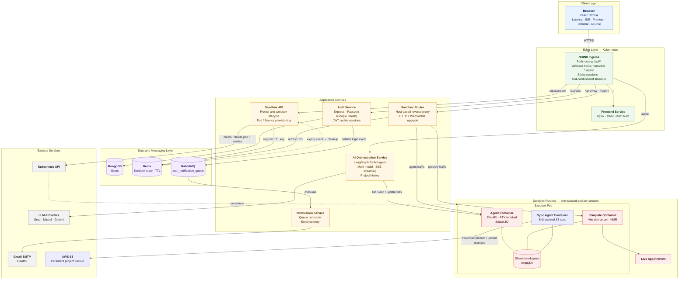
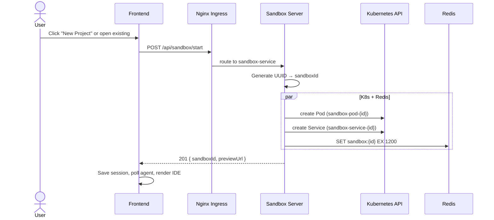
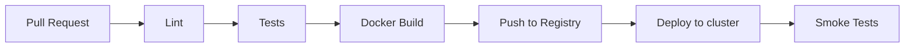

# SyncSpace — AI-Powered Cloud Sandbox IDE


---

## Table of Contents

1. [Executive Summary](#1-executive-summary)
2. [Features](#2-features)
3. [High-Level Architecture](#3-high-level-architecture)
4. [Microservices Breakdown](#4-microservices-breakdown)
5. [Sandbox Lifecycle](#5-sandbox-lifecycle)
6. [AI Code Editing Layer](#6-ai-code-editing-layer)
7. [Data Models & Schemas](#7-data-models--schemas)
8. [Kubernetes Cluster Design](#8-kubernetes-cluster-design)
9. [Developer Setup & Local Development](#9-developer-setup--local-development)
10. [Environment Variables Reference](#10-environment-variables-reference)
11. [API Reference](#11-api-reference)
12. [CI/CD Pipeline](#12-cicd-pipeline)
13. [Security Considerations](#13-security-considerations)
14. [Observability](#14-observability)
15. [Roadmap & Known Limitations](#15-roadmap--known-limitations)
16. [Contributing Guide](#16-contributing-guide)
17. [License](#17-license)

---

## 1. Executive Summary

**SyncSpace** is a browser-based cloud IDE that provisions an isolated, disposable React + Vite sandbox for each user session inside a Kubernetes cluster. Every sandbox is a dedicated pod seeded with a starter template. The user works in an IDE-style interface with a live preview pane, a file explorer, a code viewer, an integrated terminal, and an AI chat panel.

The AI agent is built with **LangChain + LangGraph** and can be backed by **Groq, Mistral, or Gemini** models, selectable from a dropdown in the chat panel. It lists, reads, and updates files directly inside the running pod. Vite's hot module replacement then updates the preview without a full reload, so the user watches the app being built in the same tab.

**Target users:** Frontend developers, students, and educators who want a zero-setup coding environment with AI assistance and no local install.

**Core value proposition:** Sign in with Google, start a sandbox in one click, describe what you want in plain English, and watch the AI write the code and hot-reload it live.

---

## 2. Features

| Area | Feature |
|---|---|
| **Authentication** | Google OAuth 2.0 sign-in (Passport), JWT issued as an `httpOnly` cookie, user records persisted in MongoDB |
| **Sandboxes** | One-click, per-user, ephemeral pods created on demand through the Kubernetes API with automatic resource bounds |
| **Project Management** | Project dashboard in UI to create, list, and resume persistent user projects saved in MongoDB |
| **Persistent Storage** | Bidirectional file synchronization between sandbox workspace and AWS S3 via dedicated in-pod `sync-agent` |
| **Live preview** | Sandbox app served on its own subdomain (`<id>.preview.localtest.me`) with working HMR over WebSockets |
| **AI agent** | LangGraph ReAct agent with `list_files`, `read_files`, and `update_files` tools that edit the real workspace |
| **Multi-model** | Model registry (Groq gpt-oss-120b, Mistral Small, Gemini Flash) exposed through `GET /api/ai/models`; chosen model remembered in browser |
| **Streaming chat** | Server-Sent Events stream agent responses; tool activity (listing, reading, updating files) appears in real time |
| **Chat History** | Multi-turn conversation and tool execution history persisted in MongoDB (`HistoryEvent`) across sessions |
| **Resilience** | Retry with backoff using a `MongoDBSaver` / `MemorySaver` checkpointer, resuming from checkpoint on 429 rate limits |
| **Terminal** | Real PTY shell inside the sandbox (`node-pty`) rendered with xterm.js over Socket.IO |
| **File tools** | List, read, create, and update files in the workspace over a REST API (accepting `files` or `updates` payload) |
| **IDE UI** | Resizable panes, file explorer, code viewer, preview iframe, tool-activity chips, loading and project dashboard |
| **Session restore** | Active sandbox restored from `sessionStorage` after a liveness probe of the agent |
| **Auto cleanup** | 20-minute Redis TTL keys expire idle sandboxes; sandbox server deletes pod and service via keyspace notification |
| **Notifications** | Login events published to RabbitMQ and sent as emails by a separate notification service |
| **Deployment** | Dockerized services, Kubernetes manifests, nginx Ingress, RBAC, and Skaffold for live-reload dev |

---

## 3. High-Level Architecture

SyncSpace is organized into five layers: a client layer, an edge layer, application services, a data and messaging layer, and an isolated sandbox runtime.



### 3.1 Layer Responsibilities

| Layer | Components | Responsibility |
|---|---|---|
| **Client** | React SPA | Landing, IDE workspace, live preview, terminal, and AI chat |
| **Edge** | NGINX Ingress, Frontend Service | Single entry point; path-based and wildcard-host routing; serves the static build |
| **Application** | Auth, AI Orchestration, Sandbox API, Router, Notification | Identity, AI agent execution, sandbox provisioning, traffic routing, and event-driven notifications |
| **Data & Messaging** | MongoDB, Redis, RabbitMQ | User persistence, sandbox state and TTL, and asynchronous events |
| **Sandbox Runtime** | Sandbox pod (agent + template containers) | Isolated execution of user projects with file access, terminal, and live preview |
| **External** | LLM providers, Gmail SMTP, Kubernetes API | Model inference, email delivery, and cluster resource management |

### 3.2 Core Request Flows

| Flow | Path |
|---|---|
| **Sign-in** | Browser → Ingress → Auth → MongoDB; Auth → RabbitMQ → Notification → Gmail SMTP |
| **Create sandbox** | Browser → Ingress → Sandbox API → Kubernetes API (pod + service) and Redis (TTL key) |
| **AI edit** | Browser → Ingress → AI Orchestration → LLM; AI Orchestration → Sandbox Agent (file tools) → shared workspace → Vite HMR → preview |
| **Live preview** | Browser → Ingress → Router → Vite dev server in the sandbox pod |
| **Terminal** | Browser → Ingress → Router → Agent (Socket.IO + PTY) |
| **Idle cleanup** | Router refreshes the Redis TTL on each request; on expiry, Sandbox API deletes the pod and service |

---

## 4. Microservices Breakdown

### 4.1 Auth Service

| Field | Value |
|---|---|
| **Directory** | `auth/` |
| **Responsibility** | Google OAuth 2.0 login, JWT issuance, user persistence, login-event dispatch |
| **Runtime** | Node.js 20 / ES Modules, Express |
| **Port** | 3000 |
| **Dockerfile** | `auth/dockerfile` (`node:20-alpine`) |
| **K8s** | `k8s/auth-deployment.yml`, `k8s/auth-service.yml` (port 80 → 3000) |

**How it works:** Passport runs the Google strategy with `session: false`. On callback the service finds or creates the user, signs a JWT (1 hour expiry), and sets it in an `httpOnly` cookie named `token` (7-day `maxAge`, `secure` and `sameSite: none` in production, optional `COOKIE_DOMAIN`). It then redirects to `FRONTEND_URL` and publishes a login event to RabbitMQ.

**Key packages:** `passport`, `passport-google-oauth20`, `jsonwebtoken`, `mongoose`, `amqplib`, `cookie-parser`, `morgan`

---

### 4.2 AI Orchestration Service

| Field | Value |
|---|---|
| **Directory** | `ai-orchestration/` |
| **Responsibility** | Hosts the LangGraph ReAct agent, streams responses via SSE, proxies tool calls to the per-sandbox agent |
| **Runtime** | Node.js 20 / ES Modules, Express |
| **Port** | 3000 |
| **Layout** | `server.js`, `src/app.js`, `src/routes/agent.routes.js`, `src/agents/code.agent.js`, `src/agents/tool.js` |
| **Dockerfile** | `ai-orchestration/dockerfile` (`node:20-alpine`) |
| **K8s** | `k8s/ai-deployment.yml`, `k8s/ai-service.yml` |

**Highlights:**
- `code.agent.js` defines a `MODELS` registry (Groq `gpt-oss-120b`, Mistral Small, Gemini Flash) and builds the agent with `createReactAgent`.
- `tool.js` implements the three file tools against `http://sandbox-service-<projectId>:3000`.
- Retry-with-backoff on provider `429` errors resumes from the last `MemorySaver` checkpoint.

**Key packages:** `langchain`, `@langchain/langgraph`, provider packages for Groq, Mistral, and Gemini, `axios`, `zod`, `morgan`

---

### 4.3 Notification Service

| Field | Value |
|---|---|
| **Directory** | `notification/` |
| **Responsibility** | Consumes `auth_notification_queue` and sends login-alert emails via Gmail OAuth2 |
| **Runtime** | Node.js 20 / ES Modules, Express (thin shell for health endpoints) |
| **Port** | 4000 |
| **K8s** | `k8s/notification-deployment.yml`, `k8s/notification-service.yml` (port 80 → 4000) |

This keeps email delivery decoupled from the login flow: a slow or failing mail provider never blocks sign-in.

**Key packages:** `amqplib`, `nodemailer`, `morgan`

---

### 4.4 Sandbox Server

| Field | Value |
|---|---|
| **Directory** | `sandbox/server/` |
| **Responsibility** | Creates sandbox pods and services on demand; registers TTL keys in Redis; deletes expired sandboxes |
| **Runtime** | Node.js 22 / ES Modules, Express |
| **Port** | 3000 |
| **K8s** | Runs with `serviceAccountName: resource-manager` |

`POST /api/sandbox/start` creates a Pod (labelled `app=sandbox-instance`) and a matching ClusterIP Service, then returns `{ sandboxId, previewUrl }`.

**Key packages:** `@kubernetes/client-node`, `ioredis`, `uuid`, `express`, `morgan`

---

### 4.5 Sandbox Router

| Field | Value |
|---|---|
| **Directory** | `sandbox/router/` |
| **Responsibility** | Subdomain-based reverse proxy with CORS support for previews and agent traffic, including WebSocket upgrades; refreshes the sandbox TTL on each request |
| **Runtime** | Node.js 20 (alpine) / ES Modules, Express + raw `http.Server` |
| **Port** | 3000 |

| Host pattern | Target |
|---|---|
| `{sandboxId}.preview.localtest.me` | `http://sandbox-service-{sandboxId}:80` (Vite on 5173) |
| `{sandboxId}.agent.localtest.me` | `http://sandbox-service-{sandboxId}:3000` (agent) |

The router reads the `Host` header, splits on `.`, and picks the target from the subdomain (`localtest.me` resolves wildcards to `127.0.0.1` locally). WebSocket upgrades (Vite HMR and Socket.IO) are handled on the server's `upgrade` event via `httpxy`. If a sandbox is booting or unreachable, the router returns a clean `503 Service Unavailable` with CORS headers (`Access-Control-Allow-Origin: *`) to prevent browser CORS errors during polling.

**Key packages:** `http-proxy-middleware`, `httpxy`, `ioredis`, `morgan`

---

### 4.6 Sandbox Agent (Sidecar)

| Field | Value |
|---|---|
| **Directory** | `sandbox/agent/` |
| **Responsibility** | In-pod file API and interactive terminal for `/workspace` |
| **Runtime** | Node.js 20 on Debian bullseye (needed to build `node-pty`), Express + Socket.IO |
| **Port** | 3000 |

**REST endpoints:** `GET /list-files`, `GET /read-files?files=a,b`, `PATCH /update-files` (accepts `{ files: [...] }` or `{ updates: [...] }`), `POST /create-files`, `GET /` (health).

**Socket.IO events:** `terminal-input` (client → server keystrokes) and `terminal-output` (server → client PTY data). A single shared shell serves the sandbox.

**Key packages:** `node-pty`, `socket.io`, `cors`, `express`, `morgan`

---

### 4.7 Sandbox Template

| Field | Value |
|---|---|
| **Directory** | `sandbox/template/` |
| **Responsibility** | Plain React + Vite (JavaScript) starter copied into every new sandbox |
| **Runtime** | Node.js 20 alpine, serves on `:5173` |

The same image runs as the init container (seeding the shared volume) and as the main container (running the dev server).

---

### 4.8 Sync Agent (Sidecar)

| Field | Value |
|---|---|
| **Directory** | `sandbox/sync-agent/` |
| **Responsibility** | Persistent cloud storage via bidirectional AWS S3 sync |
| **Runtime** | Node.js 20 alpine, AWS SDK v3, Chokidar |
| **Port** | 4000 |

On sandbox initialization, `sync-agent` checks the S3 bucket (`syncspace-bucket`) under `${projectId}/`. If existing project files exist, it downloads them into `/workspace`. A persistent `chokidar` file watcher then streams any file additions or modifications directly to S3, ensuring project persistence even across sandbox destructions.

**Key packages:** `@aws-sdk/client-s3`, `chokidar`, `dotenv`

---

### 4.9 Frontend

| Field | Value |
|---|---|
| **Directory** | `frontend/` |
| **Stack** | React 19, Vite 8, Tailwind CSS 4, `@xterm/xterm` 6 + addon-fit, `socket.io-client` 4 |
| **Serving** | Multi-stage Docker build (`node:22-alpine`) served by `nginx:1.27-alpine` with SPA fallback, gzip, immutable caching for `/assets/`, and a `/healthz` probe (or `Dockerfile.dev` with Vite for local dev) |

| Component | Description |
|---|---|
| `LandingScreen` | Entry point; starts a new sandbox or opens existing projects from the dashboard |
| `LoadingScreen` | Shown while the pod boots |
| `IDELayout` | Overall workspace layout |
| `FileExplorer` | Tree view of workspace files |
| `CodeEditor` | Code viewer for the selected file |
| `PreviewPane` | iframe showing `<id>.preview.localtest.me` |
| `TerminalPane` | xterm.js terminal connected to the agent over Socket.IO |
| `ChatPanel` | AI chat with model dropdown and SSE streaming |
| `ToolActivityChip` | Shows live file activity from the agent |
| `RightPanel`, `ResizeDivider` | Resizable side panels (`useResizablePanes` hook) |

**Supporting code:** `SandboxContext`, `services/api.js`, `services/parseSSE.js`, `utils/session.js`, `config.js`.

**App flow:** landing → loading → IDE. The session is saved in `sessionStorage` and restored after a liveness probe of the agent. The chosen model is saved in `localStorage` under `syncspace_model`.

---

## 5. Sandbox Lifecycle

### 5.1 Provisioning Flow



### 5.2 Pod Specification

- **Init container:** runs the `template` image and copies `/workspace` into a shared `emptyDir` volume.
- **`template` container:** runs the Vite dev server on port 5173.
- **`agent` container:** runs the file API and PTY server on port 3000.
- **`sync-agent` container:** runs the S3 sync watcher on port 4000.

All containers mount the same `emptyDir` volume. A file written by the agent is immediately visible to Vite's watcher (triggering HMR) and to `sync-agent` (triggering S3 sync).

### 5.3 Per-Sandbox Service

```yaml
ports:
  - name: http        # port 80  -> targetPort 5173  (Vite preview)
  - name: agent-http  # port 3000 -> targetPort 3000 (agent API)
selector:
  sandboxId: <id>     # unique per pod, prevents cross-sandbox routing
type: ClusterIP
```

### 5.4 TTL & Cleanup

1. On creation, `sandbox:{id}` is stored in Redis with a 1200-second (20 minutes) TTL.
2. Every request through the router refreshes the TTL, so active sessions stay alive.
3. The sandbox server subscribes to `__keyevent@0__:expired`. When a key expires, it deletes the pod and service.
4. Workspace files remain safely backed up in AWS S3 and project metadata in MongoDB.

---

## 6. AI Code Editing Layer

### 6.1 Agent Architecture

A LangGraph ReAct agent acts as a senior frontend engineer. It receives a user message, decides which tools to call, executes them, reads the results, and repeats until it can give a final answer.

| Tool | HTTP call | Purpose |
|---|---|---|
| `list_files` | `GET http://sandbox-service-{id}:3000/list-files` | Returns all workspace file paths |
| `read_files` | `GET http://sandbox-service-{id}:3000/read-files?files=...` | Returns contents of requested files |
| `update_files` | `PATCH http://sandbox-service-{id}:3000/update-files` | Writes full file contents, creating directories as needed |

The agent talks to the sandbox over Kubernetes internal DNS (`sandbox-service-{sandboxId}`).

### 6.2 Request & Streaming

```
POST /api/ai/invoke
Body: { message: string, projectId: string, model?: string }
```

`projectId` is the `sandboxId`. The response is `text/event-stream`: tool-activity lines first (listing, reading, updating files), then the final answer. The frontend's `parseSSE.js` classifies each chunk, and `ChatPanel` renders activity chips under the user's message in real time. The chat input becomes ready again once the agent finishes.

### 6.3 Multi-Model Support

`GET /api/ai/models` returns the model registry:

| Provider | Model |
|---|---|
| Groq | `gpt-oss-120b` |
| Mistral | Mistral Small |
| Google | Gemini Flash |

The user picks a model in the chat panel; its id is sent as `model` in the invoke request.

### 6.4 Rate-Limit Resilience

The agent uses a `MemorySaver` checkpointer. If a provider returns `429`, the service retries with backoff and resumes from the last checkpoint rather than starting over.

### 6.5 Hot Reload

Writes land on the shared volume. Vite's watcher detects the change and pushes an HMR update over `ws://{id}.preview.localtest.me`, so the preview iframe updates without a full reload.

### 6.6 Error Handling

- If streaming has already started, errors end the stream gracefully; otherwise the API returns `500`.
- Tool errors (for example, file not found) are returned as strings so the agent can reason about them and recover.
- Writes use recursive directory creation, so new files in new folders need no separate step.

---

## 7. Data Models & Schemas

### 7.1 User (MongoDB, `auth` database)

| Field | Type | Constraints |
|---|---|---|
| `_id` | `ObjectId` | PK |
| `googleId` | `String` | required, unique |
| `email` | `String` | required, unique |
| `name` | `String` | required |
| `avatar` | `String` | optional |
| `createdAt` / `updatedAt` | `Date` | automatic timestamps |

```javascript
const userSchema = new mongoose.Schema({
  googleId: { type: String, required: true, unique: true },
  email:    { type: String, required: true, unique: true },
  name:     { type: String, required: true },
  avatar:   { type: String }
}, { timestamps: true });
```

### 7.2 Project (MongoDB, `sandbox` database)

| Field | Type | Constraints |
|---|---|---|
| `_id` | `ObjectId` | PK |
| `user` | `ObjectId` | required, references User |
| `title` | `String` | default: `"Untitled Project"` |

```javascript
const projectSchema = new mongoose.Schema({
  user:  { type: mongoose.Schema.Types.ObjectId, required: true },
  title: { type: String, default: "Untitled Project" }
});
```

### 7.3 HistoryEvent (MongoDB, `ai` database)

Stores multi-turn conversational chat messages and tool activity across project sessions.

| Field | Type | Description |
|---|---|---|
| `projectId` | `String` | Sandbox / Project ID (indexed) |
| `eventId` | `String` | Unique event identifier |
| `type` | `String` | `'user'`, `'tool'`, `'assistant'`, `'rate_limit'` |
| `tool` | `String` | Tool name (e.g. `'list_files'`, `'read_files'`, `'update_files'`) |
| `status` | `String` | Execution status |
| `message` | `String` | User or activity display string |
| `paths` | `[String]` | Files affected |
| `content` | `String` | Assistant text response or user prompt |
| `createdAt` | `Date` | Timestamp |

### 7.4 Sandbox State (Redis)

- **Key:** `sandbox:{sandboxId}`
- **Value:** `{ "status": "active" }`
- **TTL:** 1200 seconds (20 minutes), refreshed by the router on each request

### 7.5 Queue Payload

**Queue:** `auth_notification_queue` (durable)

| Field | Type | Description |
|---|---|---|
| `userId` | `String` | User `_id` |
| `action` | `String` | Currently `"google_login"` |
| `timestamp` | `Date` | Event time |
| `email` | `String` | User email |

---

## 8. Kubernetes Cluster Design

### 8.1 Workloads

| Deployment | Image | Notes |
|---|---|---|
| `auth-deployment` | `auth` | Google OAuth + JWT |
| `ai-deployment` | `ai-orchestration` | LangGraph agent + MongoDB checkpointer |
| `sandbox-deployment` | `sandbox` | Uses `resource-manager` service account |
| `router-deployment` | `router` | Host-based proxy with CORS handling |
| `notification-deployment` | `notification` | RabbitMQ consumer |
| `frontend-deployment` | `frontend` | Vite dev / nginx serving the React SPA; Ingress catch-all |

Dynamic pods (one per sandbox) run the `template`, `agent`, and `sync-agent` images.

### 8.2 Services

| Service | Type | Port |
|---|---|---|
| `auth-service` | ClusterIP | 80 → 3000 |
| `ai-service` | ClusterIP | 80 → 3000 |
| `sandbox-service` | ClusterIP | 80 → 3000 |
| `router-service` | ClusterIP | 80 → 3000 |
| `notification-service` | ClusterIP | 80 → 4000 |
| `frontend-service` | ClusterIP | 80 → 5173 |
| `sandbox-service-{id}` | ClusterIP | 80 → 5173, 3000 → 3000 |

### 8.3 Ingress

An nginx Ingress routes `/api/auth`, `/api/sandbox`, and `/api/ai` to their services, `*.preview.localtest.me` and `*.agent.localtest.me` to the router, and everything else to the frontend. It is tuned for streaming: response buffering off, cookie-based session affinity, and long proxy timeouts for SSE and WebSockets.

### 8.4 RBAC

A `resource-manager` ServiceAccount, Role, and RoleBinding allow the sandbox server to `get`, `list`, `watch`, `create`, and `delete` **pods** and **services** in the `default` namespace, and nothing else.

### 8.5 Secrets

Sensitive values (database URLs, JWT secret, Google credentials, model API keys, AWS credentials) are stored in Kubernetes `Opaque` Secrets and injected through `secretKeyRef`.

### 8.6 Storage & Persistence

- Inside the pod, the containers mount a shared `emptyDir` volume for high-speed local filesystem operations and Vite HMR.
- Long-term persistence is achieved via the `sync-agent` sidecar, which streams changes to **AWS S3** (`syncspace-bucket`) and restores existing project files upon pod creation. Project metadata is stored in **MongoDB**.

---

## 9. Developer Setup & Local Development

### 9.1 Prerequisites

| Tool | Minimum version |
|---|---|
| Node.js | 20.x (22.x for the frontend build and sandbox server images) |
| npm | 10.x |
| Docker | 24.x |
| kubectl | 1.28+ |
| minikube or kind | recent |
| Skaffold | v2.x |
| nginx Ingress Controller | latest |

### 9.2 Run the Full Stack

```bash
# 1. Clone
git clone <repo-url>
cd SyncSpace

# 2. Start a local cluster
minikube start --driver=docker --cpus=4 --memory=8g
minikube addons enable ingress

# 3. Build images inside the cluster's Docker daemon
eval $(minikube docker-env)

# 4. Create secrets from template or configure individual secret files in k8s/
cp k8s/secrets.example.yml k8s/secrets.local.yml   # fill in your own values
kubectl apply -f k8s/secrets.local.yml

# 5. Apply RBAC
kubectl apply -f k8s/rbac.yml

# 6. Build and deploy with live reload
skaffold dev
```

Skaffold builds the service images (`ai-orchestration`, `agent`, `sync-agent`, `router`, `sandbox`, `template`, `auth`, `notification`, `frontend`) and applies the manifests in `k8s/`.

### 9.3 Frontend Dev Server

```bash
cd frontend
npm install
npm run dev        # http://localhost:5173
```

In development, Vite proxies `/api`, `/agent-proxy/<id>`, and `/preview-proxy/<id>` to the cluster ingress on `localhost:80`, rewriting the `Host` header to `<id>.agent.localtest.me` or `<id>.preview.localtest.me`. The terminal connects straight to `http://<id>.agent.localtest.me` through `getAgentSocketUrl`.

### 9.4 Wildcard DNS

SyncSpace uses the `*.localtest.me` wildcard domain for sandbox previews and agent endpoints (`<id>.preview.localtest.me` and `<id>.agent.localtest.me`). Public DNS resolvers automatically map all `*.localtest.me` domains to `127.0.0.1` (loopback), requiring zero manual DNS setup or `/etc/hosts` changes.

### 9.5 Running a Single Service

```bash
cd auth && npm install && npm run dev            # port 3000
cd ai-orchestration && npm install && npm run dev # port 3000
cd notification && npm install && npm run dev     # port 4000
cd sandbox/server && npm install && npm run dev   # needs a valid kubeconfig
cd sandbox/router && npm install && npm run dev   # port 3000
cd sandbox/agent && npm install && npm run dev    # port 3000
cd sandbox/sync-agent && npm install && node sync.js
```

### 9.6 Try a Sandbox from the Command Line

```bash
# Start a sandbox
curl -X POST http://localhost/api/sandbox/start
# { "sandboxId": "...", "previewUrl": "http://<id>.preview.localtest.me" }

# List files
curl "http://<id>.agent.localtest.me/list-files"

# Update files
curl -X PATCH http://<id>.agent.localtest.me/update-files \
  -H "Content-Type: application/json" \
  -d '{"files":[{"file":"src/App.jsx","content":"export default () => <h1>Hello SyncSpace</h1>"}]}'
```

---

## 10. Environment Variables Reference

### Auth Service

| Variable | Description | Required |
|---|---|---|
| `AUTH_MONGO_URI` / `AUTH` | MongoDB connection string | Yes |
| `GOOGLE_CLIENT_ID` | Google OAuth client ID | Yes |
| `GOOGLE_CLIENT_SECRET` | Google OAuth client secret | Yes |
| `GOOGLE_CALLBACK_URL` | OAuth callback URL | Yes |
| `JWT_SECRET` | Secret for signing JWTs (min 32 characters) | Yes |
| `FRONTEND_URL` | Where to redirect after login | Yes |
| `COOKIE_DOMAIN` | Optional cookie domain | No |
| `RABBITMQ_URL` | AMQP connection URL | Yes |

### AI Orchestration Service

| Variable | Description | Required |
|---|---|---|
| `MONGODB_URI` | MongoDB connection for checkpointer & history | Recommended |
| `GROQ_API_KEY` | Groq API key | For Groq models |
| `GEMINI_API_KEY` | Google Gemini API key | For Gemini models |
| `MISTRAL_API_KEY` | Mistral API key | For Mistral models |

### Notification Service

| Variable | Description | Required |
|---|---|---|
| `RABBITMQ_URL` | AMQP connection URL | Yes |
| `EMAIL_USER` | Gmail address used to send | Yes |
| `GOOGLE_CLIENT_ID` / `GOOGLE_CLIENT_SECRET` | OAuth credentials for Gmail | Yes |
| `GOOGLE_REFRESH_TOKEN` | Gmail OAuth2 refresh token | Yes |

### Sandbox Server and Router

| Variable | Description | Required |
|---|---|---|
| `REDIS_URL` | Redis URL (`redis://` or `rediss://`) | Yes |
| `SANDBOX` | MongoDB connection string for Project metadata | Yes |
| `JWT_SECRET` | Secret for verifying auth cookies on sandbox endpoints | Yes |

### Sync Agent (AWS S3)

| Variable | Description | Required |
|---|---|---|
| `PROJECT_ID` | Unique project identifier | Injected by Pod spec |
| `AWS_ACCESS_KEY_ID` | AWS IAM access key ID | Yes |
| `AWS_SECRET_ACCESS_KEY` | AWS IAM secret access key | Yes |
| `AWS_REGION` | AWS S3 bucket region (e.g. `ap-south-1`) | Yes |

### Sandbox Agent

| Variable | Description | Required |
|---|---|---|
| `SHELL` | Shell for the PTY (defaults to `bash`) | No |

---

## 11. API Reference

### 11.1 Auth (`/api/auth`)

| Method | Endpoint | Description |
|---|---|---|
| `GET` | `/api/auth/google` | Starts Google OAuth |
| `GET` | `/api/auth/google/callback` | Upserts user, sets JWT cookie, redirects to the frontend |
| `GET` | `/_status/healthz` | Liveness probe |
| `GET` | `/_status/readyz` | Readiness probe |

### 11.2 Sandbox Server (`/api/sandbox`)

All `/api/sandbox` endpoints verify user JWT authentication via `token` cookie or `Authorization: Bearer <token>`.

| Method | Endpoint | Request Body | Response | Description |
|---|---|---|---|---|
| `POST` | `/api/sandbox/project` | `{ title: string }` | `201 { message, project }` | Creates a new user project in MongoDB |
| `GET` | `/api/sandbox/project` | none | `200 { message, projects }` | Lists all projects owned by the authenticated user |
| `POST` | `/api/sandbox/start` | `{ projectId?: string, title?: string }` | `201 { message, sandboxId, previewUrl }` | Provisions pod, service, S3 sync, and TTL key |
| `GET` | `/api/sandbox/health` | none | `200` | Health check |

### 11.3 AI Orchestration (`/api/ai`)

| Method | Endpoint | Request Body | Response | Description |
|---|---|---|---|---|
| `GET` | `/api/ai/models` | none | `{ models: [...], default: string }` | List of available models whose API keys are configured |
| `POST` | `/api/ai/invoke` | `{ message, projectId, model? }` | `text/event-stream` | Streams tool activity and AI assistant response |
| `GET` | `/api/ai/history/:projectId` | none | `{ history: [...] }` | Retrieves saved conversation and tool event history |
| `DELETE` | `/api/ai/history/:projectId` | none | `{ success: true }` | Clears conversation history and LangGraph checkpoints |

### 11.4 Sandbox Agent (`{id}.agent.localtest.me`)

| Method | Endpoint | Request Body / Query | Description |
|---|---|---|---|
| `GET` | `/list-files` | none | Lists workspace files (excludes `node_modules`, `.git`, `dist`) |
| `GET` | `/read-files` | `?files=a,b` | Reads file contents |
| `PATCH` | `/update-files` | `{ files: [...] }` or `{ updates: [...] }` | Writes or overwrites workspace files |
| `POST` | `/create-files` | `{ files: [...] }` | Creates new workspace files |
| `GET` | `/` | none | Health check with CORS headers |

**Socket.IO:** `terminal-input` (client → server) and `terminal-output` (server → client).

---

## 12. CI/CD Pipeline

### 12.1 Current Setup

**Skaffold** is the build and deploy orchestrator for development. It builds the Docker images, syncs `src/**` for fast iteration on supported services, and applies the manifests in `k8s/`.

### 12.2 Recommended GitHub Actions Pipeline



| Stage | Tool |
|---|---|
| Lint | ESLint (`npm run lint`) |
| Test | Vitest / Jest |
| Build | Docker Buildx, tagged with git SHA |
| Push | GHCR or Docker Hub |
| Deploy | `kubectl apply` or ArgoCD |

---

## 13. Security Considerations

### 13.1 Sandbox Isolation

- Each sandbox runs in its own pod with calibrated CPU and memory limits.
- Each per-sandbox Service selects on a unique `sandboxId`, so traffic cannot cross sandboxes.
- Workspace storage is an `emptyDir` with no host mount.
- File paths in the agent API are joined under `/workspace` to block traversal.

### 13.2 Authentication

- Google OAuth 2.0 with a short-lived JWT in an `httpOnly` cookie.
- The sandbox server validates the user JWT before creating or listing projects and provisioning pods.
- The sandbox server ServiceAccount (`resource-manager`) follows least privilege (only pods and services in `default`).

### 13.3 Secrets

Keep real credentials out of git. All secret files in `k8s/` and `.env` are git-ignored. Use `k8s/secrets.example.yml` as a template for local development.

### 13.4 Hardening Checklist

- [x] Enforce JWT verification on `/api/sandbox/project` and `/api/sandbox/start`.
- [ ] Enforce JWT verification on `/api/ai/invoke`.
- [ ] Add a shared-secret check on the sandbox agent API.
- [ ] Add `securityContext` to sandbox containers (`runAsNonRoot`, `allowPrivilegeEscalation: false`).
- [ ] Add NetworkPolicies so sandbox pods only accept traffic from the router and AI service.
- [ ] Add rate limiting on AI and sandbox-creation endpoints.
- [ ] Use TLS at the Ingress for production.

---

## 14. Observability

- **Logging:** `morgan` request logs on every service, written to stdout for the cluster log driver.
- **Health probes:** each service exposes liveness and readiness endpoints (`/_status/healthz`, `/api/status/healthz`, `/api/sandbox/health`); the frontend nginx exposes `/healthz`.
- **Planned:** structured JSON logs, Prometheus metrics (`prom-client`), OpenTelemetry tracing, and alerting on pod restarts and AI error rates.

---

## 15. Roadmap & Known Limitations

### 15.1 Known Limitations

| Limitation | Impact |
|---|---|
| No authentication enforced on AI invoke endpoint | Anyone can trigger AI generation for a known `projectId` |
| Sandbox pods have no `securityContext` | Containers run as root inside the pod namespace |
| No rate limiting | Possible cluster or LLM token exhaustion |
| Services run `nodemon` in their container `CMD` | Dev tooling in images; use `node server.js` for production |
| Single shared shell per sandbox | Multiple terminal clients in the same sandbox share one PTY session |

### 15.2 Feature Status

| Feature | Status | Notes |
|---|---|---|
| Google OAuth & JWT Authentication | **Completed** | Passport.js + `httpOnly` cookie |
| Ephemeral Sandbox Pods | **Completed** | Multi-container pods on Kubernetes |
| Subdomain Ingress & Proxy Router | **Completed** | Host-based routing via `*.localtest.me` |
| Persistent Project Dashboard | **Completed** | MongoDB Project collection + UI |
| Persistent S3 Storage Sync | **Completed** | Chokidar watcher + AWS S3 sync agent |
| Multi-Model AI Agent | **Completed** | Groq, Gemini Flash, Mistral Small |
| Multi-Turn AI Conversation History | **Completed** | MongoDBSaver + `HistoryEvent` model |
| SSE Streaming & Tool Activity Chips | **Completed** | Server-Sent Events with LangGraph |
| PTY Terminal via Socket.IO | **Completed** | `node-pty` + xterm.js |
| Rate-limit Resilience (429 backoff) | **Completed** | LangGraph checkpoint resumption |
| AI edit history and undo | Planned (Medium) | Versioning snapshots in S3/Git |
| Real-time multi-user collaboration | Planned (Medium) | CRDTs / Yjs over WebSocket |
| Multi-language sandbox templates | Planned (Medium) | Node.js, Python, Next.js starters |

---

## 16. Contributing Guide

### 16.1 Branch Naming

| Pattern | Use |
|---|---|
| `feat/<description>` | New features |
| `fix/<description>` | Bug fixes |
| `chore/<description>` | Tooling and config |
| `docs/<description>` | Documentation |
| `refactor/<description>` | Restructuring without behavior change |

### 16.2 Pull Requests

1. Branch from `main` and rebase before opening a PR.
2. Title format: `<type>(<scope>): <subject>`, for example `fix(ai): handle 429 retry on resume`.
3. Describe what changed, why, and how to test it.
4. Make sure lint and build pass.

**Review checklist:**

- [ ] No secrets or credentials in code or manifests
- [ ] New endpoints have at least a basic test
- [ ] K8s manifests include resource requests and limits
- [ ] Health probes updated when adding a service or port
- [ ] README updated if the architecture changes

### 16.3 Code Style

- All Node.js services use ES Modules (`"type": "module"`).
- ESLint is configured per service; run `npm run lint` before committing.
- Follow [Conventional Commits](https://www.conventionalcommits.org/): `feat`, `fix`, `chore`, `docs`, `refactor`, `test`, `perf`.

---

## 17. License

No license has been declared yet. Add a `LICENSE` file (for example MIT or ISC) before publishing or distributing the code.

```
Copyright (c) 2026 <your name>
```