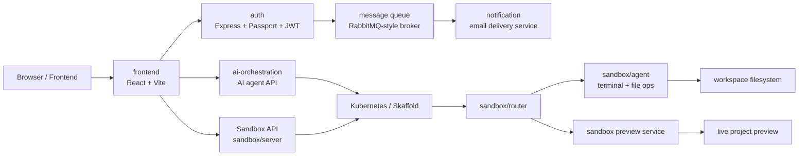

# SyncSpace

SyncSpace is a full-stack developer workspace platform that combines secure authentication, AI-powered orchestration, and isolated sandbox environments for project creation and live preview.

It is designed for a workflow where a user can:

- sign in with Google
- create or manage projects
- launch a disposable sandbox environment
- interact with a project through an AI coding agent
- preview the running app in a browser
- use a terminal and file APIs inside the sandbox

---

## Overview

SyncSpace is organized as a microservice-style monorepo with a React frontend and several Node.js backend services. The platform separates concerns into:

- authentication and session management
- AI orchestration and project intelligence
- sandbox provisioning and routing
- terminal/file execution inside isolated workspaces
- notification handling for auth events
- Kubernetes-based deployment automation

---

## Architecture at a Glance



---

## High Level Design

### 1. Frontend Layer
The frontend is a single-page React application that provides:

- login experience with Google authentication
- project creation and management
- sandbox launch flow
- IDE-like project workspace UI
- live preview access for running apps
- terminal interaction experience

### 2. Authentication Layer
The `auth` service handles user identity and secure login via Google OAuth.

Responsibilities:

- Passport-based Google sign-in
- JWT generation and cookie-based session handling
- user model persistence
- auth notification events sent to the messaging layer

### 3. AI Orchestration Layer
The `ai-orchestration` service acts as the coordination layer for AI-driven code work.

Responsibilities:

- project lifecycle APIs
- sandbox creation requests
- project history management
- model selection and AI invocation
- streaming responses back to the frontend

This layer integrates with sandbox resources and stores event history for project threads.

### 4. Sandbox Environment Layer
The sandbox system is the execution environment where user projects are created and run.

Key components:

- `sandbox/server`: exposes sandbox APIs for health checks, project access, and project lifecycle management
- `sandbox/agent`: runs a persistent shell using a PTY and supports terminal input, file listing, file reads, file writes, and file creation
- `sandbox/router`: routes traffic to the correct sandbox preview or agent endpoint dynamically based on hostname
- `sandbox/sync-agent` and related sandbox templates: support isolated application execution and runtime environments

This is where the project gets a live, ephemeral, browser-accessible workspace.

### 5. Messaging and Notifications
The `notification` service consumes auth-related queue messages and sends email notifications. This decouples the auth flow from notification delivery and keeps operations resilient.

### 6. Deployment Model
The infrastructure uses Kubernetes manifests and Skaffold for deployment orchestration.

- service discovery is handled through Kubernetes services
- ingress routes external traffic to the appropriate app endpoint
- environment-specific secrets are maintained under `k8s/`
- local or cluster development is accelerated by `skaffold.yml`

---

## Repository Structure

```text
SyncSpace/
├── ai-orchestration/         # AI orchestration service
│   ├── src/
│   ├── package.json
│   └── dockerfile
├── auth/                    # Authentication service
│   ├── src/
│   ├── package.json
│   └── dockerfile
├── frontend/                # React frontend
│   ├── src/
│   ├── package.json
│   ├── Dockerfile
│   └── README.md
├── notification/            # Email / notification consumer
│   ├── src/
│   ├── package.json
│   └── dockerfile
├── sandbox/                 # Isolated coding environment
│   ├── agent/
│   ├── router/
│   ├── server/
│   ├── sync-agent/
│   ├── template/
│   └── ...
├── k8s/                     # Kubernetes manifests and secrets
├── skaffold.yml             # Local orchestration / dev workflow
├── .gitignore
├── Readme.md
└── ...
```

---

## Tech Stack

### Frontend
- React
- Vite
- Tailwind CSS
- Socket.IO client
- XTerm integration for terminal UX

### Backend
- Node.js
- Express
- Passport.js
- JWT
- MongoDB via Mongoose
- RabbitMQ-style messaging for queued notification events

### Runtime and Infrastructure
- Docker
- Kubernetes
- Skaffold
- Local preview routing via dynamic host-based sandbox routing

---

## Core Features

- Google OAuth authentication
- Secure cookie-based JWT auth flow
- project creation and sandbox provisioning
- isolated developer workspaces
- live terminal inside the sandbox
- file listing, reading, creation, and update operations
- AI-driven project assistance and streaming responses
- browser-based preview for sandbox apps
- notification pipeline for authentication events

---

## How It Works

1. A user authenticates through the frontend and `auth` service.
2. The frontend requests project or sandbox creation through the AI orchestration layer.
3. A sandbox is provisioned in Kubernetes and assigned a stable public-facing route.
4. The user can interact with the workspace through file APIs and a terminal.
5. The AI service can inspect workspace state and respond with code changes or instructions.
6. The running app is served through the sandbox preview proxy.
7. Auth events can trigger notifications via the messaging layer.

---

## Local Development

### Prerequisites

- Node.js 18+
- npm
- Docker
- Kubernetes tooling (for local cluster/dev namespace if you want the full platform)
- Skaffold

### Install dependencies

From the repo root, install dependencies for the relevant services:

```bash
cd auth && npm install
cd ../ai-orchestration && npm install
cd ../notification && npm install
cd ../frontend && npm install
cd ../sandbox/server && npm install
cd ../sandbox/agent && npm install
cd ../sandbox/router && npm install
```

### Run frontend

```bash
cd frontend
npm run dev
```

### Run backend services individually

Each service usually has its own startup mode, for example:

```bash
cd auth
npm run dev
```

```bash
cd ai-orchestration
npm run dev
```

```bash
cd notification
npm run dev
```

### Run the full stack with Skaffold

```bash
skaffold dev
```

This is the preferred option when you want the Kubernetes-based service graph and sandbox routing setup to behave like the intended deployment model.

---

## Environment Variables

Several services depend on environment variables such as:

- `GOOGLE_CLIENT_ID`
- `GOOGLE_CLIENT_SECRET`
- `GOOGLE_CALLBACK_URL`
- `FRONTEND_URL`
- `JWT_SECRET`
- MongoDB connection settings
- messaging / queue configuration
- Kubernetes / sandbox runtime variables

Copy the sample configuration patterns from the service directories and fill in the required values before running the platform in a real environment.

---

## Security Notes

This project includes authentication and cookie-based token handling, but production deployments should also include:

- secure secret management
- strict CORS configuration
- RBAC restrictions for Kubernetes
- encrypted secrets storage
- environment-specific validation for inbound requests
- TLS termination through an ingress or reverse proxy

---

## Use Cases

SyncSpace is well-suited for:

- AI-assisted software prototyping
- browser-based coding environments
- project scaffolding with live preview
- isolated developer sandboxes
- learning and experimentation with AI-driven workflows

---

## Future Enhancements

Potential extensions for the platform include:

- persistent project storage
- richer multi-user collaboration
- role-based access control
- project templates and starter apps
- deeper AI code review and validation workflows
- better observability, logs, and telemetry
- more robust resource isolation for sandbox lifecycle management

---

## License

This project does not currently declare a license in the repository root. Please confirm the intended project license before publishing or distributing the code.

---

## Summary

SyncSpace is a modern AI-assisted coding and sandbox platform that unifies authentication, AI orchestration, workspace management, and isolated runtime execution. Its architecture is designed to give users a secure and interactive developer experience from ideation to live preview.
